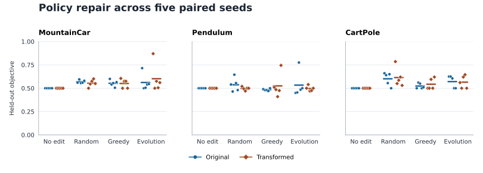

# Offline policy repair pilot

Three classic-control tasks were evaluated with no edit, random search, greedy coordinate search, and an evolution strategy. Each task used one generated policy fixture at seed `90217` and five paired search seeds `41, 43, 47, 53, 59`. Conditions were the original weights and a compensated hidden-unit permutation plus positive ReLU rescaling. All 120 planned cells completed. The pilot made zero live editor or API calls.



Each marker shows one seed outcome. The short bars show five-seed means. Original and transformed markers have the same left-to-right seed order within their respective groups. All panels use the full objective scale.

## Design and budget

The objective averages failure-start recovery and normal-start retention with equal weight. For each task and seed, all methods and parameterizations used the same eight development starts per region. Across all seeds for a task, the holdout was one fixed panel of 100 starts per region. Development feedback selected the candidate, and held-out evaluation ran after selection.

Search arms shared the edit validator and a ceiling of 25 candidates, including the starting policy. Each of the 90 search cells used all 25 slots. Each of the 30 no-edit cells used one slot. Each development reservation covered the number of starts times the horizon. Measured policy rows count one forward per active start at each simulator step. Earlier termination reduces measured rows. The [policy repair guide](../../docs/policy-repair.md) describes how the proposals differ across methods and how the limits are applied.

| Phase | Rows used | Rows reserved |
| --- | ---: | ---: |
| Development | 9,097,696 | 10,944,000 |
| Held-out after selection | 5,905,285 | 7,200,000 |

All 2,280 development candidates were scored. Compensated starting policies were checked on 1,000 fixed float64 inputs per task and seed. The largest absolute logit difference was `4.55e-13`. The corresponding maximum for selected policies transported into the paired coordinates was `6.82e-13`. The transport check measures numerical agreement for that change of coordinates. The policy repair comparison reruns search separately in the two parameterizations.

## Held-out objective

All means below use five seeds. The paired interval estimates original minus transformed with 2,000 percentile bootstrap resamples of the five whole pairs, using bootstrap seed `20261119`. Development drop is development objective minus held-out objective.

| Task | Method | Original mean | Transformed mean | Paired difference [95% interval] | Original drop | Transformed drop |
| --- | --- | ---: | ---: | ---: | ---: | ---: |
| MountainCar | No edit | 0.500 | 0.500 | 0.000 [0.000, 0.000] | 0.000 | 0.000 |
| MountainCar | Random | 0.570 | 0.554 | +0.016 [-0.018, +0.050] | +0.055 | +0.046 |
| MountainCar | Greedy | 0.553 | 0.551 | +0.002 [-0.037, +0.043] | +0.047 | +0.037 |
| MountainCar | Evolution | 0.561 | 0.602 | -0.041 [-0.104, +0.011] | +0.051 | +0.048 |
| Pendulum | No edit | 0.500 | 0.500 | 0.000 [0.000, 0.000] | 0.000 | 0.000 |
| Pendulum | Random | 0.537 | 0.497 | +0.040 [-0.016, +0.112] | +0.050 | +0.065 |
| Pendulum | Greedy | 0.484 | 0.525 | -0.041 [-0.149, +0.037] | +0.078 | +0.087 |
| Pendulum | Evolution | 0.533 | 0.497 | +0.036 [-0.057, +0.175] | +0.054 | +0.053 |
| CartPole | No edit | 0.500 | 0.500 | 0.000 [0.000, 0.000] | 0.000 | 0.000 |
| CartPole | Random | 0.601 | 0.614 | -0.013 [-0.075, +0.054] | +0.061 | +0.024 |
| CartPole | Greedy | 0.524 | 0.543 | -0.019 [-0.071, +0.027] | +0.051 | +0.020 |
| CartPole | Evolution | 0.571 | 0.565 | +0.006 [-0.077, +0.077] | +0.042 | -0.015 |

All nine search intervals for original minus transformed include zero. These exploratory, unadjusted intervals quantify uncertainty over five paired search seeds on the released policies and holdouts. With five pairs, intervals that include zero leave representation sensitivity unresolved. The pilot supplies baseline behavior on these fixtures. It contains no estimate of language-model editing performance, and transfer to fresh tasks or checkpoints remains open.

## Data and replay

- [cells.csv](cells.csv) gives every cell's selection, development and held-out rates and counts, checkpoint and split digests, and measured and reserved policy rows.
- [summary.json](summary.json) contains all 24 groups and 30 paired comparisons for the objective and both components. It includes each search arm's paired gain over no edit, run spread, and intervals for development-to-held-out change.
- [events.jsonl](events.jsonl) contains structured candidate requests, normalized edits, evaluation scores, policy digests, transform records, and selections. The keys `run_id` and `sequence` identify each event.
- [manifest.json](manifest.json) records source and module hashes, input and normalized config hashes, runtime versions, file hashes, evaluation counts, and the fixture archive checksum.
- [config.json](config.json) is the frozen runnable input. The companion fixture archive contains the exact three policies, start panels, standalone demonstrations, and generator manifests needed for replay. These historical evaluation panels are now public. Use new held-out fixtures for prospective comparisons. [Fixture archive](https://github.com/Abelo9996/weight-space-programming/releases/download/baseline-pilot-2026-11-19/baseline-pilot-2026-11-19-fixtures.tar.gz)

From the repository root, run the following with Python 3.12. The original run used Python 3.12.13, NumPy 2.2.6, and PyTorch 2.7.1 on macOS arm64 with single-thread numerical settings. Exact replay across platforms, CPU kernels, and library versions can vary. The archive preserves the input bytes so replay does not depend on replicating the training process.

```sh
replay_dir="$(mktemp -d)"
mkdir "$replay_dir/source"
git archive a5758a3df5d3f0decd8d7d2d9cc4b1fba8913c13 | tar -x -C "$replay_dir/source"
cp results/baseline-pilot-2026-11-19/config.json "$replay_dir/config.json"

curl -fL -o "$replay_dir/baseline-pilot-2026-11-19-fixtures.tar.gz" \
  https://github.com/Abelo9996/weight-space-programming/releases/download/baseline-pilot-2026-11-19/baseline-pilot-2026-11-19-fixtures.tar.gz
(
  cd "$replay_dir"
  printf '%s  %s\n' 677956d26dcacd60ce4f31a1cd49dd648509d2d19a340dd725f377bdb5855b40 \
    baseline-pilot-2026-11-19-fixtures.tar.gz | shasum -a 256 -c -
  tar -xzf baseline-pilot-2026-11-19-fixtures.tar.gz
  shasum -a 256 -c SHA256SUMS
)
python3.12 -m venv "$replay_dir/venv"
"$replay_dir/venv/bin/python" -m pip install \
  'numpy==2.2.6' 'torch==2.7.1' "$replay_dir/source"
VECLIB_MAXIMUM_THREADS=1 OPENBLAS_NUM_THREADS=1 OMP_NUM_THREADS=1 \
  "$replay_dir/venv/bin/weightspace" run --config "$replay_dir/config.json" --output "$replay_dir/replay"
"$replay_dir/venv/bin/weightspace" summarize --input "$replay_dir/replay" \
  --output "$replay_dir/summary.json" --bootstrap-replicates 2000 --bootstrap-seed 20261119
```

To recheck the published table and intervals from the text records alone, run `python -m pytest -q tests/results` with the development dependencies. To redraw the SVG, install Matplotlib 3.11.2 in a separate plotting environment and run the following from the repository root.

```sh
python scripts/plot_baseline_results.py \
  results/baseline-pilot-2026-11-19/cells.csv \
  results/baseline-pilot-2026-11-19/heldout-objective.svg
```
